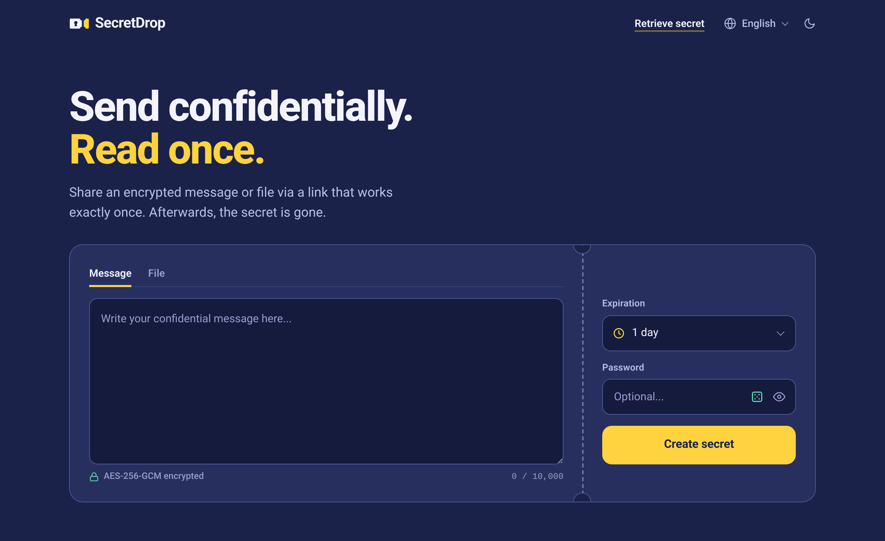

# SecretDrop

This is the source code of [SecretDrop.to](https://secretdrop.to), a free service for sharing one-time secrets. Messages and files are encrypted in your browser before they are uploaded, so the server cannot read what it stores. It deletes a secret after the first retrieval or when it expires.

- Onion service: http://secretdimtmcoa7iq2lqkmwmrbze5qknena75f5xlge226jmxfrcg5yd.onion

- Our official addresses, PGP-signed: https://secretdrop.to/mirrors.txt



## What it does

You write a message or pick up to 10 files (50 MB in total) and get a link. The recipient opens it once, and then it is deleted. If nobody opens it, it expires after the time you chose: 1 hour to 7 days for messages, up to 3 days for files.

You can add a password, which the recipient needs in addition to the link. The dice button suggests one made of five random words. After five wrong passwords the secret is deleted. Instead of the link you can also send a code or show a QR code.

Before anything is uploaded, your browser removes metadata such as the GPS location from JPEG, PNG and WebP images and gives files random names. Both are on by default. Other image formats are only uploaded once you turn metadata removal off, and other files are uploaded unchanged. There are no accounts, no cookies of our own and no analytics. SecretDrop is also available as a Tor onion service, without Cloudflare and without a third-party bot check.

## How it works

```
Sender's browser            Server                      Recipient's browser

random key, or a key from
the password (Argon2id)
encrypts the secret
gets an ID and ticket <---- hands out the ID
computes the tag
uploads ciphertext, ------> stores them, but cannot
salt and tag                decrypt them

link .../#<id>.<key> ..... sent by you, not by us ....> opens the link

                            <-------------------------- asks for the salt
                            sends the salt -----------> derives the key and
                                                        computes the tag
                            <-------------------------- sends the tag
                            checks the tag, deletes
                            the secret, sends the
                            ciphertext ---------------> decrypts it
```

Without a password, the key is random and stays in the part of the link after `#`, which browsers do not send to the server. With a password, the link carries only the ID, and the key is derived from the password with Argon2id. From the key, HKDF derives one key for AES-256-GCM and one for the verification tag, an HMAC over the ID. The server never receives a key or a password.

Before encryption, every message, and every set of files up to 32 KB, is padded to the same size. Larger uploads are rounded up with the Padmé scheme to one of about 320 sizes, so the stored size reveals little about the content. Deleted secrets are overwritten in the database file instead of just being marked as free. The full description is on our [security page](https://secretdrop.to/security).

## Contents

- `web/` is the website as it is served to your browser: pages, styles, scripts, translations and word lists.
- `server/` is the API (`server.js`, Node.js with Express). It stores and hands out the encrypted secrets.

Not included are the server configuration (nginx, Tor, firewall) and our operational scripts. The warrant canary is renewed at least every 31 days and is only published on the website: https://secretdrop.to/canary

## Checking the live site

The files in `web/` are the ones our server delivers. You can compare them with what your browser loads, for example in its developer tools or with a checksum:

```
curl -s https://secretdrop.to/js/crypto.js | sha256sum
sha256sum web/js/crypto.js
```

This shows what you were served at that moment. It cannot show what runs on our server, and it cannot rule out that a single visitor gets different code. Our [security page](https://secretdrop.to/security) lists these limits in its threat model.

The HTML pages use nginx server-side includes (`<!--#include virtual="..." -->`) for the footer, the notice bar and the signed texts, so in the delivered pages these parts appear inline.

## Running it yourself

To run your own copy, you need a web server in front of the API. Ours does the following:

- serves `web/` with server-side includes turned on, and maps `/faq`, `/security` and the other short paths to their `.html` files
- blocks direct access to `/_includes/` and `/_errors/`
- forwards `/api/` to the API on `127.0.0.1:3000`
- on `/api/store`, sets `X-Access-Channel` to `clearnet` or `onion` and `X-Upload-Time` to the duration of the upload in seconds, and accepts bodies up to the size set in `SECRETDROP_MAX_PAYLOAD`
- limits requests per visitor
- writes no access or error logs
- sends a strict Content-Security-Policy and further security headers, which you can see in the responses of secretdrop.to

Uploads over the clearnet need a Cloudflare Turnstile key pair. Over the onion service, the browser solves a small proof of work instead.

The pages contain our addresses, our PGP key and our legal texts, so your own copy needs its own.

To start the API:

```
cd server
npm ci
node server.js
```

It needs a current Node.js release with the built-in `node:sqlite` module and listens on `127.0.0.1:3000`. All limits are set on the server as environment variables, which are listed at the top of `server.js`. Without them, the API does not start.

## Feedback

We do not accept pull requests. Please send bug reports and suggestions by email to secretdropto@protonmail.com, encrypted with our PGP key (see [SECURITY.md](SECURITY.md)).

## Reporting security issues

See [SECURITY.md](SECURITY.md).

## License

Copyright (C) 2026 SecretDrop. SecretDrop is free software, licensed under the GNU Affero General Public License v3.0 only, see [LICENSE](LICENSE). It comes without any warranty. If you run a modified version for others, you have to offer them its source code.

The license does not grant any rights to the name SecretDrop or its logo.

Third-party components and their licenses are listed in [web/licenses.txt](web/licenses.txt).
